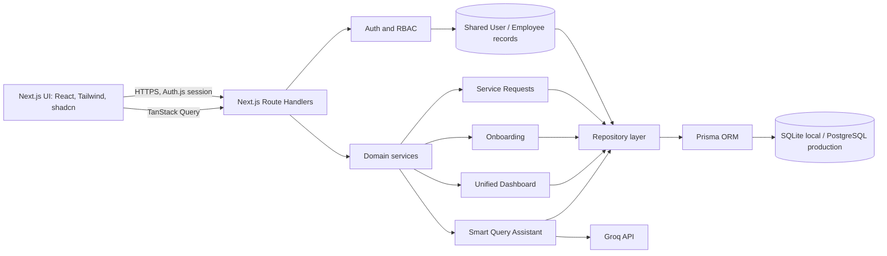
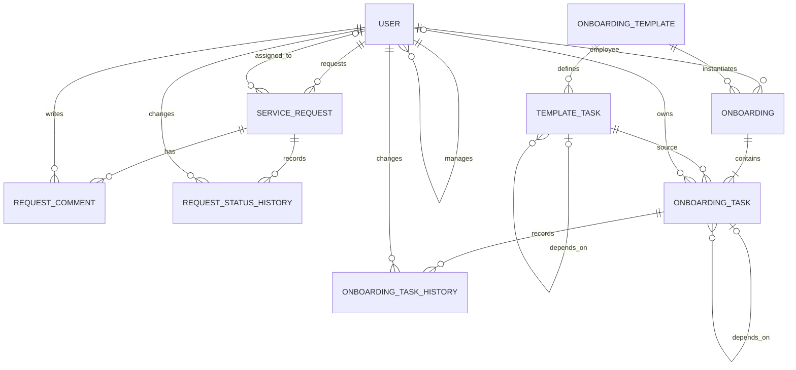

# HRIS Operations Platform — Architecture

> **Status:** proposed design, written before implementation per the assessment. This is the target design; update the implementation notes when code diverges. Local development uses SQLite. Production targets PostgreSQL (Supabase). The assessment specification permits any stack; this project follows the requested Next.js/Prisma stack.

## Requirement-to-feature mapping

| Assessment requirement | Planned feature / evidence |
|---|---|
| Shared authentication and three roles | Auth.js credentials session; server-side role and ownership checks |
| 100 employees, 4 countries, 4 departments | Deterministic seed: Bangladesh, Malaysia, Sri Lanka, Cyprus; Engineering, People & Culture, Finance, Marketing |
| Service requests, 5 categories/statuses/priorities, comments | Request list/create/detail, assignment and transition actions, comments, filters; 30+ seed requests |
| Onboarding templates and execution | Versioned checklist templates, onboarding instances, owned tasks, date offsets, dependencies, progress and overdue indicators; 5–10 seed hires |
| Unified admin view and cross-module insight | Headcount, request counts/chart, onboarding progress, new-hire open request insight |
| Live-data AI feature | HR-admin Smart Query Assistant with allowlisted intents and parameterized repository queries; Groq response generation, provenance, safe fallback |
| Architecture/API/access/state/trade-offs | This document, including ERD, permission matrix, API catalogue, state rules, and decisions |
| Seeded reviewer-ready data | Idempotent Prisma seed and role demo credentials documented in README |
| Debugging evidence | `DEBUG_LOG.md` records only issues actually reproduced during implementation |

## Proposed folder structure

```text
src/app/                     Next.js App Router pages and route handlers
  (auth)/login/               Sign-in UI
  (workspace)/                Role-aware dashboard and workflow pages
  api/                        REST handlers; thin request/response layer
src/components/               Shared UI, navigation, forms, tables, charts
src/lib/
  auth/                       Session and authorization helpers
  validation/                 Zod request schemas
  db/                         Prisma client and repositories
  domains/                    Service request, onboarding, dashboard services
  ai/                         Provider interface, Groq adapter, safe query intents
prisma/                       Schema, migrations, deterministic seed
src/**/*.test.ts              Unit tests
e2e/                           Browser tests
docs/                         Optional supporting implementation notes
```

Route handlers validate input, authenticate, authorize, call a domain service, and serialize results. Domain services own transition rules. Repositories isolate Prisma and do not leak database-provider details into UI or business rules. Client components use TanStack Query; forms use React Hook Form and Zod. Dashboard charts use Recharts.

## High-level architecture



Both workflows reference the same employee identities. Service requests and onboarding instances are separate domain records; shared user, manager, country, department, and role data are stored once. AI never receives database credentials or arbitrary SQL capability.

## Data model and ERD

All IDs are UUID strings; timestamps are UTC. Enum values below are persisted domain values. Unique and foreign-key constraints are required in Prisma.

| Entity | Important fields and constraints |
|---|---|
| `User` | `id`, unique `email`, `passwordHash`, `fullName`, `employeeNumber` (unique), `country`, `department`, `role`, `employmentStatus`, `joiningDate`, nullable `managerId` (self-reference), `createdAt`, `updatedAt`; manager cannot be self |
| `ServiceRequest` | `id`, unique `requestNumber`, `title`, `description`, `category`, `priority`, `status`, `requesterId`, nullable `assigneeId`, `createdAt`, `updatedAt`, nullable `resolvedAt`, `closedAt`; user references are FKs |
| `RequestComment` | `id`, `requestId`, `authorId`, `body`, `createdAt`; cascade delete with request, retain author FK |
| `RequestStatusHistory` | `id`, `requestId`, `actorId`, nullable `fromStatus`, `toStatus`, optional `note`, `createdAt`; append-only audit trail |
| `OnboardingTemplate` | `id`, `name`, `description`, `active`, `version`, `createdById`, timestamps |
| `TemplateTask` | `id`, `templateId`, `title`, `description`, `department`, `ownerRole` (or optional `ownerId`), `dueOffsetDays`, `sortOrder`, nullable `dependsOnTemplateTaskId`; unique `(templateId, sortOrder)`; dependency must be in same template and acyclic |
| `Onboarding` | `id`, `employeeId` (unique while active; enforce in service), `templateId`, `startDate`, `status`, `createdById`, timestamps |
| `OnboardingTask` | `id`, `onboardingId`, `templateTaskId`, copied title/description/department/offset, nullable `ownerId`, `dueDate`, `status`, nullable `dependsOnTaskId`, `completedAt`, timestamps; unique `(onboardingId, templateTaskId)` |
| `OnboardingTaskHistory` | `id`, `taskId`, `actorId`, `fromStatus`, `toStatus`, optional `note`, `createdAt`; append-only status audit |
| `Session` / `Account` | Auth.js adapter records if required by selected session mode; session token unique and expiring. Credentials hashes remain on `User`, never returned by APIs. |



SQLite is suitable for deterministic local development and Prisma integration tests. PostgreSQL is the production target because Vercel instances do not provide durable local files. Prisma relations and portable scalar fields keep the domain model shared; provider-specific migrations are kept separate and migration/seed procedures are documented. No application query relies on SQLite-only SQL. Dashboard aggregation may be calculated with portable Prisma queries and validated against records.

## RBAC permission matrix

Authorization is checked in every server action/route handler through shared helpers. Middleware only gates entry to protected pages; it is not the authorization boundary. Record scope is applied in repository queries before returning data. Managers can access a record only where the requester/employee is their direct report. An employee sees only their own requests and onboarding. Never accept role, requester ID, or ownership from client input when it can be derived from the session.

| Capability | Employee | Manager | HR Admin |
|---|---:|---:|---:|
| View/update own profile (limited fields) | Own | Own | All |
| Directory and employee management | No | Direct reports, read | All; create/update/deactivate |
| Create service request | Yes | Yes | Yes |
| Read requests | Own | Direct reports | All |
| Assign requests | No | Team requests | All |
| Move assigned request to In Progress / Resolved | No | If assignee | If assignee or admin override, audited |
| Close request | Requester after resolution | Team requests | All |
| Comment | Visible request | Visible request | All |
| View onboarding | Own | Direct reports | All |
| Manage templates / create onboarding | No | No | Yes |
| Update onboarding task | Assigned task | Assigned task / direct report task | All, audited |
| Unified analytics | Personal summary | Team summary | Organization-wide |
| Smart Query Assistant | No | No | Yes |

## API catalogue

All JSON bodies are validated with Zod. Responses use `{ data }`; failures use `{ error: { code, message } }`. IDs are opaque strings. Collection endpoints accept documented filters and pagination (`cursor`, `limit`, capped at 100).

| Method and path | Request → response | Authorization |
|---|---|---|
| `POST /api/auth/login` | `{email,password}` → `{data:{user,redirectTo}}` | Public; rate limited |
| `POST /api/auth/logout` | empty → `{data:{ok:true}}` | Authenticated |
| `GET /api/auth/session` | — → `{data:{user,role}}` | Authenticated |
| `GET /api/users` | country/department/role/status/search → `{data:User[],nextCursor}` | Admin all; manager direct reports; employee denied |
| `POST /api/users` | employee fields + temporary password → `{data:User}` | HR Admin |
| `GET /api/users/:id` | — → `{data:User}` | Self, manager scope, or admin |
| `PATCH /api/users/:id` | allowed profile/employment fields → `{data:User}` | Self limited; HR Admin full |
| `POST /api/service-requests` | `{title,description,category,priority}` → `{data:Request}` | Authenticated; requester from session |
| `GET /api/service-requests` | status/category/priority/country/search → `{data:Request[],nextCursor}` | Scoped by role |
| `GET /api/service-requests/:id` | — → request with comments/history | Scoped by role |
| `PATCH /api/service-requests/:id` | `{action,assigneeId?,note?}` → `{data:Request}` | Manager team / admin; transition policy applies |
| `POST /api/service-requests/:id/comments` | `{body}` → `{data:Comment}` | Visible request |
| `GET /api/onboarding/templates` | `active?` → `{data:Template[]}` | Admin manage; authenticated read active templates |
| `POST /api/onboarding/templates` | `{name,description,tasks[]}` → `{data:Template}` | HR Admin |
| `PATCH /api/onboarding/templates/:id` | template/task changes → `{data:Template}` | HR Admin; version on change |
| `POST /api/onboarding` | `{employeeId,templateId,startDate}` → `{data:Onboarding}` | HR Admin |
| `GET /api/onboarding` | employee/status → scoped instances and progress | Scoped by role |
| `GET /api/onboarding/:id` | — → instance/tasks/dependencies | Scoped by role |
| `PATCH /api/onboarding/tasks/:id` | `{status,ownerId?}` → `{data:Task}` | Task owner; manager scope; admin |
| `GET /api/dashboard` | optional country/date filters → counts, series, insight | Employee personal; manager team; admin organization |
| `POST /api/ai/query` | `{question}` → `{data:{answer,sources,generatedAt}}` | HR Admin only |

## State machine rules

### Service request

| From | To | Allowed actor | Rule |
|---|---|---|---|
| — | Submitted | Any authenticated employee | Creation sets requester from session and writes initial history |
| Submitted | Assigned | Manager with requester in team; HR Admin | Assignee must be active employee; history records actor |
| Assigned | In Progress | Assignee; HR Admin override | Must have assignee |
| In Progress | Resolved | Assignee; HR Admin override | Set `resolvedAt`; notify via UI state (email optional) |
| Resolved | Closed | Requester; HR Admin | Set `closedAt` |
| Resolved | In Progress | Assignee; HR Admin | Reopen with required note; clear resolved timestamp and audit |
| Assigned | Submitted | Manager/admin | Unassign with required note |

Other transitions are rejected with 409. Comments do not change status. All state changes and assignments append immutable history in the same transaction as the update.

### Onboarding task

`NOT_STARTED → IN_PROGRESS → COMPLETED`; `NOT_STARTED/IN_PROGRESS → BLOCKED` is derived from an incomplete dependency or can carry an explicit blocked reason. A task whose prerequisites are incomplete cannot move to `IN_PROGRESS` or `COMPLETED`. A dependency becoming complete removes derived blocking. `COMPLETED → IN_PROGRESS` requires HR Admin and an audit note. Due date is `startDate + dueOffsetDays` in calendar days, normalized to the employee's local date. Overdue means due before today's date and status is not completed. Instance progress is computed from task states, not stored separately.

## AI query flow and safeguards

The Smart Query Assistant accepts HR Admin questions. A small intent parser maps supported questions (counts by category/country/status, overdue tasks, open requests for new hires) to an allowlisted structured query. The repository enforces the same admin scope and returns only the minimal fields needed. Groq receives the question plus aggregate/query results, never credentials or arbitrary SQL; response includes provenance such as query type, filters, and record count. If `GROQ_API_KEY` is absent or the provider fails, the UI reports the unavailable generation path and can show deterministic database results for recognized intents. Unknown questions are declined with supported examples. Newly created records are visible because each query reads the current database.

## Trade-offs and next steps

1. **SQLite locally, PostgreSQL in production:** a single Postgres dependency simplifies deployment but slows setup and offline work. SQLite makes local assessment setup reproducible; PostgreSQL is required for durable serverless production persistence. With more time, CI would run the full integration suite against both providers and an automated migration rehearsal.
2. **Allowlisted AI queries instead of generated SQL:** generated SQL is flexible but increases injection, privacy, and correctness risk. A structured intent catalog is narrower and auditable, with an explicit unsupported-question path. With more time, expand intents, add evaluation examples, and add per-user query auditing and rate limits.
3. **Direct manager relation:** it is simple and adequate for the four-country assessment. A larger organization would need effective-dated organizational units and delegated scopes rather than a single manager foreign key.

## Development execution plan

1. Establish the Next.js strict TypeScript foundation, Prisma schema, SQLite setup, and deterministic seed.
2. Implement credentials auth, session handling, role/record-scope helpers, and employee directory.
3. Implement service-request repository/service/routes/UI and audit transitions/comments.
4. Implement onboarding template and instance services, dependencies, task ownership, and progress UI.
5. Add role-scoped dashboard aggregation and charts; compare all metrics with seeded records.
6. Integrate allowlisted live-data AI queries behind a provider interface.
7. Add unit, integration, authorization, and browser coverage; document only reproduced bugs.
8. Configure PostgreSQL/Supabase migrations and seed path, then deployment workflow and final evidence checklist.

## Implementation checklist

- [ ] Architecture, ERD, RBAC, API catalogue, state transitions, trade-offs documented before implementation.
- [ ] Strict Next.js TypeScript app, responsive role-aware UI, validation, accessible states.
- [ ] SQLite + Prisma schema, migrations, deterministic idempotent seed (100 employees; 30+ requests; 5–10 hires; 8–12 tasks per hire).
- [ ] Secure Argon2 credentials auth, session cookies, logout, protected routes, server-side ownership checks.
- [ ] Employee search/filter and authorized management.
- [ ] Request create/read/filter/assign/transitions/comments/audit.
- [ ] Onboarding templates/instances/deadline calculation/owners/dependency blocking/progress.
- [ ] Dashboard metrics, chart, and cross-module insight validated from persisted data.
- [ ] HR-only AI assistant queries live records with allowlisted intents, provenance, provider failure handling.
- [ ] Tests: unit, Prisma integration, RBAC/API, Playwright user journeys; report actual results.
- [ ] PostgreSQL migration/provider workflow, environment docs, Docker, CI, deployment configuration.
- [ ] README, seed credentials, live URL if deployed; DEBUG_LOG based only on actual bugs; final compliance checklist.
