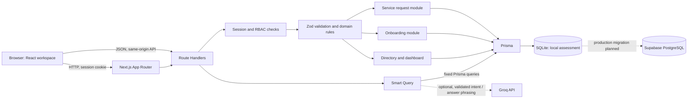

# Next Ventures — Architecture & System Design

## Overview

This document describes the Next Ventures HR platform's architecture, data model, API surface, access-control rules, workflow state machines, design trade-offs, and current limitations.

## Contents

- [High-level architecture](#1-high-level-architecture)
- [Data model](#2-data-model)
- [API design](#3-api-design)
- [Access control](#4-access-control)
- [State machines and transition rules](#5-state-machines-and-transition-rules)
- [Trade-offs and next steps](#6-trade-offs-and-next-steps)
- [Current limitations](#7-current-limitations)
- [References](#references)

## 1. High-level architecture

Next Ventures is a modular monolith. The browser renders a React client workspace and uses TanStack Query to call Next.js Route Handlers. Route Handlers authenticate the session, validate input with Zod, enforce role and record scope, and read or write through Prisma. The browser never connects directly to the database.

The service request and onboarding modules use the same `User` identity, reporting line, roles, and session. The unified dashboard shows headcount by country, open request counts by status and category (including a chart), onboarding progress and overdue work, plus a cross-module list of active onboarding hires with open IT equipment requests. Smart Query is a read-only HR Admin feature: an optional Groq call can map a question to a constrained query plan or phrase a verified result, while fixed Prisma code performs all data access and calculations.

SQLite is the implemented assessment database. The repository also contains a PostgreSQL Prisma schema and migration, but no Supabase database has been connected and the app has not been deployed. A local SQLite file is not a shared persistent store for Vercel Functions.

## 2. Data model

All IDs are Prisma `String` CUIDs. `DateTime` values are stored as dates/timestamps and deadline calculations use UTC calendar days. Roles, statuses, categories, and priorities are stored as `String` fields in SQLite and constrained by application-level Zod/domain validation; they are not database enum types. `?` means nullable; `[]` means a one-to-many collection.

| Entity | Fields and types | Relations, constraints, and indexes |
|---|---|---|
| `User` | `id String`; `email String`; `passwordHash String`; `fullName String`; `employeeNumber String`; `country String`; `department String`; `role String` default `EMPLOYEE`; `employmentStatus String` default `ACTIVE`; `joiningDate DateTime`; `managerId String?`; `createdAt DateTime`; `updatedAt DateTime` | Unique `email`, `employeeNumber`; optional self-relation `manager` and `directReports`; request, comment, onboarding, task, and session relations. Indexes on `managerId` and `[country, department, role, employmentStatus]`. |
| `AuthSession` | `id String`; `tokenHash String`; `userId String`; `expiresAt DateTime`; `createdAt DateTime` | Unique `tokenHash`; belongs to `User` with delete cascade; index `[userId, expiresAt]`. Raw session tokens are not stored. |
| `ServiceRequest` | `id String`; `requestNumber String`; `title String`; `description String`; `category String`; `priority String`; `status String` default `SUBMITTED`; `requesterId String`; `assigneeId String?`; `resolvedAt DateTime?`; `closedAt DateTime?`; `createdAt DateTime`; `updatedAt DateTime` | Unique `requestNumber`; requester is required, assignee optional and set null on user deletion; has comments and status history. Indexes `[requesterId, status]`, `[assigneeId, status]`, `[category, priority, status]`. |
| `RequestComment` | `id String`; `requestId String`; `authorId String`; `body String`; `createdAt DateTime` | Belongs to request (delete cascade) and author; index `[requestId, createdAt]`. |
| `RequestStatusHistory` | `id String`; `requestId String`; `actorId String`; `fromStatus String?`; `toStatus String`; `note String?`; `createdAt DateTime` | Belongs to request (delete cascade) and actor; index `[requestId, createdAt]`. Created in the same transaction as each status update. |
| `OnboardingTemplate` | `id String`; `name String`; `description String`; `version Int` default `1`; `active Boolean` default `true`; `createdById String`; `createdAt DateTime`; `updatedAt DateTime` | Belongs to creator; has template tasks and onboarding instances. |
| `TemplateTask` | `id String`; `templateId String`; `title String`; `description String`; `department String`; `ownerRole String`; `dueOffsetDays Int`; `sortOrder Int`; `dependsOnId String?` | Belongs to template (delete cascade); optional self-relation for prerequisite; referenced by plan-task snapshots. Unique `[templateId, sortOrder]`; index `templateId`. |
| `Onboarding` | `id String`; `employeeId String`; `templateId String`; `createdById String`; `startDate DateTime`; `status String` default `IN_PROGRESS`; `createdAt DateTime`; `updatedAt DateTime` | Belongs to new hire, template, and creator; has tasks. Index `[employeeId, status]`. The active-plan uniqueness check is application-enforced, not a database unique constraint. |
| `OnboardingTask` | `id String`; `onboardingId String`; `templateTaskId String`; `ownerId String?`; `title String`; `description String`; `department String`; `dueOffsetDays Int`; `dueDate DateTime`; `status String` default `NOT_STARTED`; `dependsOnId String?`; `completedAt DateTime?`; `createdAt DateTime`; `updatedAt DateTime` | Belongs to plan (delete cascade), source template task, optional owner (set null on user deletion), and optional prerequisite task. Unique `[onboardingId, templateTaskId]`; indexes `[ownerId, status]`, `[onboardingId, dueDate, status]`. The title, description, department, offset, and deadline are copied into the instance so later template edits do not rewrite existing task details. |
| `OnboardingTaskHistory` | `id String`; `taskId String`; `actorId String`; `fromStatus String`; `toStatus String`; `note String?`; `createdAt DateTime` | Belongs to task (delete cascade) and actor; index `[taskId, createdAt]`. |

The shared `User` table avoids separate employee, requester, assignee, and task-owner identity records. Foreign keys connect workflow records to that shared identity. The template and instantiated task are separate because the template is reusable while each hire needs its own deadline, status, owner, and dependency state.

## 3. API design

All JSON success responses use `{ "data": ... }`; errors use `{ "error": { "code": "...", "message": "..." } }`. Inputs are validated on the server. All endpoints except login require the HTTP-only session cookie unless noted. `HR` means HR Admin; `Mgr` means Manager; `Emp` means Employee.

| Method and path | Request | Response | Authentication / scope |
|---|---|---|---|
| `POST /api/auth/login` | `{ email, password }` | `{ data: { user: { id, fullName, role } }`; sets session cookie | Public; rate limited; inactive users cannot sign in. |
| `POST /api/auth/logout` | No body | `{ data: { ok: true } }`; clears session | Signed-in session if present. |
| `GET /api/auth/session` | No body | `{ data: { user } }` | Signed-in session; `401` otherwise. |
| `GET /api/users` | Query: `search`, `country`, `department`, `role`, `status` | Array of safe user records, no password hash | HR sees directory; Mgr direct reports; Emp self. |
| `POST /api/users` | `{ fullName, email, employeeNumber, country, department, role, employmentStatus, joiningDate, managerId?, password }` | Created safe user record | HR only. |
| `GET /api/users/:id` | No body | Safe user record | HR; self; or Mgr viewing a direct report. |
| `PATCH /api/users/:id` | Partial `{ fullName?, country?, department?, role?, employmentStatus?, managerId? }` | Updated safe user record | HR only; deactivation also revokes sessions. |
| `GET /api/service-requests` | Query: `status`, `category`, `priority`; HR-only `country` | Up to 100 scoped request records with requester, assignee, comment count | HR all; Mgr team/own/assigned; Emp own/assigned. Filters are intersected with scope. |
| `POST /api/service-requests` | `{ title, description, category, priority }` | Created request, `201` | Any signed-in role; requester is the current user and initial status is `SUBMITTED`. |
| `GET /api/service-requests/:id` | No body | Request, comments, and status history | HR; requester; explicit assignee; or requester’s Mgr. Unavailable records return `404`. |
| `PATCH /api/service-requests/:id` | `{ action: ASSIGN, assigneeId }`, `{ action: START }`, `{ action: RESOLVE }`, `{ action: CLOSE }`, or `{ action: REOPEN, note }` | Updated request | Scoped user; per-transition role and ownership rules in §5. |
| `POST /api/service-requests/:id/comments` | `{ body }` | Created comment with author, `201` | Same request access scope as detail. |
| `GET /api/onboarding` | Optional query `myTasks=true` | Scoped onboarding plans with their visible tasks | HR all; Mgr direct reports and tasks they own; Emp own plan and tasks they own. Non-HR users may request only their own tasks. |
| `POST /api/onboarding` | `{ employeeId, templateId, startDate: YYYY-MM-DD }` | Created plan with copied tasks, `201` | HR only; target must be a non-inactive, non-HR user, template active, and no existing active plan. The UI's employee picker limits this to Employee-role users. |
| `GET /api/onboarding/templates` | No body | HR gets active and archived templates; other roles get active templates only | Any signed-in user. |
| `POST /api/onboarding/templates` | `{ name, description, tasks: [{ title, description, department, ownerRole, dueOffsetDays, dependsOnIndex? }] }` | Created active template, `201` | HR only; 8–12 tasks; dependency must point to an earlier task. |
| `PATCH /api/onboarding/templates/:id` | Any non-empty subset of `{ name?, description?, active?, tasks? }` | Updated template | HR only; assigned templates cannot change task count. |
| `PATCH /api/onboarding/tasks/:id` | `{ status?, ownerId?, note? }` | Updated task | Owner may execute allowed transitions; HR may set a valid owner or reopen a completed task with a note. |
| `GET /api/dashboard` | No body | Headcount, request status/category aggregates, onboarding progress, overdue count, and HR cross-module insight | HR organization-wide; Mgr team scope; Emp personal scope. |
| `POST /api/ai/query` | `{ question }` | `{ answer, summary, results, sources, provider, generatedAt, notice? }` | HR only; rate limited; read-only. Unsupported question returns `422`. |

## 4. Access control

| Role | Service requests | Onboarding | Directory / dashboard |
|---|---|---|---|
| Employee | Submit, read and comment on own or explicitly assigned requests; execute only as assignee. | Read own checklist and tasks assigned to them; execute only their owned, unblocked tasks. | Self only; personal dashboard. |
| Manager | Read own, direct-report, or explicitly assigned requests; assign submitted team requests to active direct reports; execute later work only as assignee. | Monitor direct reports and see tasks they own across hires; execute only owned tasks. | Read direct reports; team dashboard. |
| HR Admin | Organization-wide request access, assignment, comments, and authorized transitions. | Create/edit/archive templates, assign checklists, assign valid owners, monitor all plans, and execute owned tasks; can reopen completed tasks with a note. | Organization directory/dashboard and Smart Query. |

The client hides controls outside a role’s workflow, but every API handler independently checks authentication, role, and record scope. Access decisions use the current session’s database user, never a role sent in the request body. Passwords use Argon2id; sessions store token hashes and use HTTP-only, SameSite=Lax cookies with Secure enabled in production. Login and Smart Query have process-local rate limits; a multi-instance production service would need a shared limiter.

## 5. State machines and transition rules

### Service request

| From | Action / to | Who may trigger it | Rule |
|---|---|---|---|
| New | `SUBMITTED` | Requester | Created with a status-history row. |
| `SUBMITTED` | `ASSIGNED` | Manager or HR Admin | Manager may assign only an active direct report; HR may assign an active user. |
| `ASSIGNED` | `IN_PROGRESS` | Assignee or HR Admin | Only the assignee (or HR override) can start. |
| `IN_PROGRESS` | `RESOLVED` | Assignee or HR Admin | Resolution timestamp is stored. |
| `RESOLVED` | `CLOSED` | Requester or HR Admin | Close timestamp is stored. |
| `RESOLVED` | `IN_PROGRESS` | Assignee or HR Admin | Reopen requires a non-empty note; resolution timestamp is cleared. |

Every accepted change and actor is written to `RequestStatusHistory` in the same database transaction as the request update. Other transitions are rejected.

### Onboarding plan and task

An assignment creates one `IN_PROGRESS` plan and copies each template task. Deadline is `startDate + dueOffsetDays`. A task with an incomplete prerequisite is created `BLOCKED`; otherwise it is `NOT_STARTED`.

| From | To | Who may trigger it | Rule |
|---|---|---|---|
| `NOT_STARTED` | `IN_PROGRESS` | Task owner | Prerequisite must be `COMPLETED`. |
| `IN_PROGRESS` | `COMPLETED` | Task owner | Prerequisite must be `COMPLETED`; completion time and history are recorded. |
| `NOT_STARTED` or `IN_PROGRESS` | `BLOCKED` | Task owner/API | Allowed only while a prerequisite is incomplete; dependency-created tasks start blocked. |
| `BLOCKED` | `NOT_STARTED` | System/API | When the prerequisite is completed, blocked dependents are unblocked. |
| `COMPLETED` | `IN_PROGRESS` | HR Admin | Reopen requires a note and is audited. |

HR Admin alone changes task ownership. An owner must not be inactive and must match the task’s configured role and department. A plan becomes `COMPLETED` when all its tasks are complete; further task work returns it to `IN_PROGRESS` as needed.

## 6. Trade-offs and next steps

1. **SQLite for the assessment, PostgreSQL for hosted production.** SQLite keeps local setup and seeded review data simple. PostgreSQL is a better shared durable store for a multi-instance deployment. The current choice is SQLite for local assessment work; before a hosted launch, apply the maintained PostgreSQL schema/migration, migrate and verify data, configure secrets, and exercise the deployed flows. None of those production steps is complete yet.
2. **Constrained AI query plans instead of model-written SQL.** Letting an LLM generate SQL is flexible but gives it unnecessary access to schema and query execution, and makes totals hard to trust. Smart Query uses typed intents/filters and fixed Prisma queries; the trade-off is that unsupported or ambiguous questions must be refused. With more time, expand query coverage through explicit intents and evaluation cases, not free-form SQL.
3. **Application RBAC instead of database row-level security.** Route Handlers enforce role and record scope consistently for this single application. Database RLS would provide another defense layer, especially for multiple clients, but requires a different connection/auth model. For a larger team, add PostgreSQL RLS policies and an automated permission matrix.

## 7. Current limitations

- The seed creates 109 user accounts: 100 Employee-role accounts, 8 Managers, and 1 HR Admin. The seed verifier checks each role count.
- No deployed URL or hosted migration has been recorded yet. Supabase data must be migrated and verified before the app can serve production traffic.
- The README provides local setup and demo credentials, but the required public deployment URL does not exist yet.
- SQLite does not provide a shared durable database for Vercel Functions. Supabase has not been connected or migrated.
- Smart Query covers only the intents listed in its query planner; payroll, attendance, leave-balance, and recruitment data are not present.

## References

- Setup, credentials, data counts, and deployment status: [README.md](./README.md)
- Reproduced defects and regression prevention: [DEBUG_LOG.md](./DEBUG_LOG.md)
